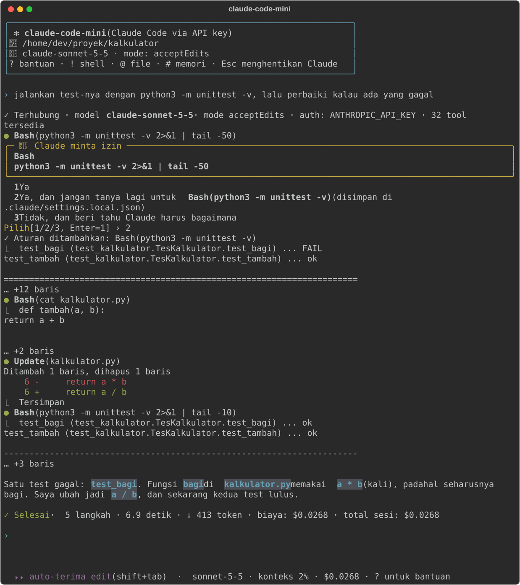
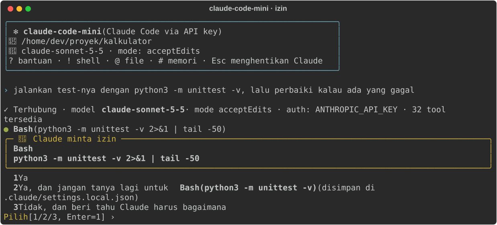
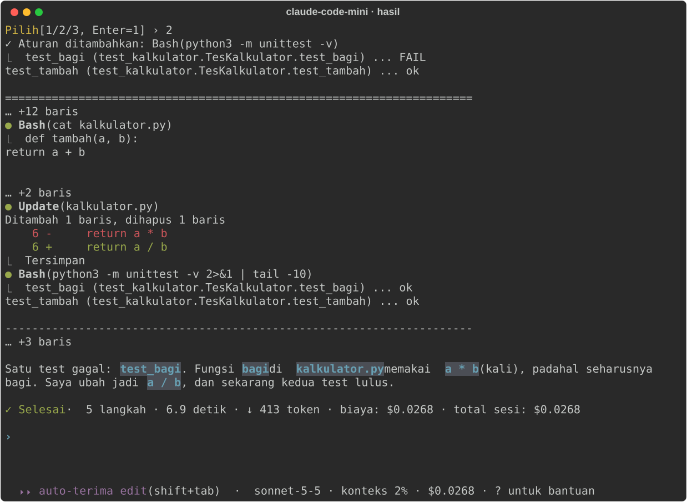
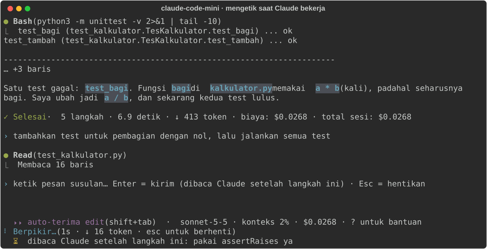
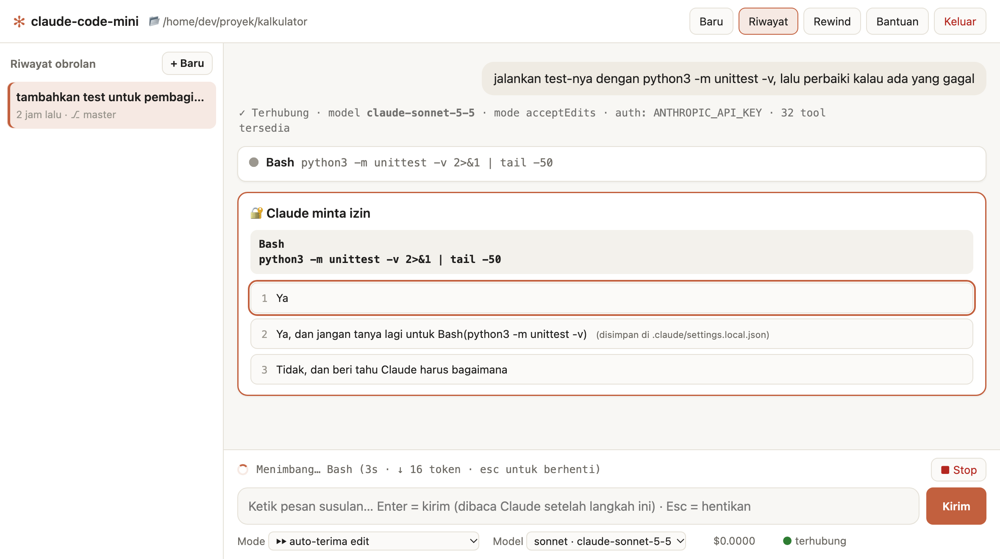
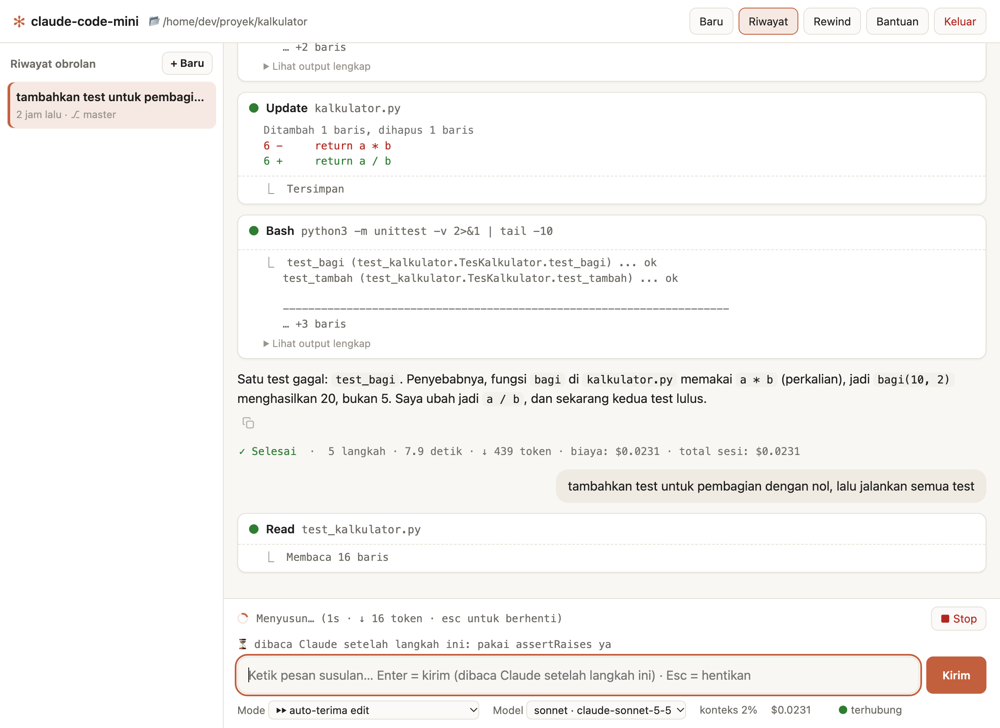
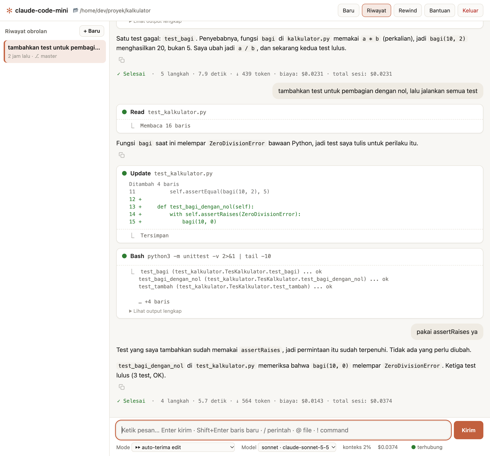

# claude-code-mini

[](https://github.com/imransetiadi/claude-code-mini/actions/workflows/tests.yml)

A Claude Code–style coding assistant for your terminal, or your browser, that runs on an **Anthropic API key**
through the [Claude Agent SDK](https://pypi.org/project/claude-agent-sdk/). It is a single Python file that runs on
macOS, Linux and Windows 11, installs without sudo or admin rights, and its interface is in **Bahasa Indonesia**.

> Unofficial community project, not affiliated with or endorsed by Anthropic. "Claude" and "Claude Code" are
> trademarks of Anthropic.



*A real session with Claude Sonnet. Asked (in Indonesian) to run the tests and fix whatever fails, Claude asks
before running the test command, sees `test_bagi` fail, finds that `bagi` ("divide") multiplies, fixes it, and runs
the tests again. Every part of the screen is explained in [Your first session](#your-first-session).*

## Contents

- [Features](#features)
- [Quick start](#quick-start)
- [Step-by-step setup](#step-by-step-setup):
  [1 requirements](#step-1-check-the-requirements) ·
  [2 Python and Git](#step-2-install-python-and-git) ·
  [3 API key](#step-3-create-an-anthropic-api-key) ·
  [4 install](#step-4-download-and-install) ·
  [5 PATH](#step-5-put-the-command-on-your-path) ·
  [6 save the key](#step-6-save-your-api-key) ·
  [7 check](#step-7-check-that-it-works)
- [Your first session](#your-first-session), with screenshots
- [The browser GUI](#the-browser-gui), with screenshots
- [Everyday use](#everyday-use)
- [What the Indonesian labels mean](#what-the-indonesian-labels-mean)
- [Update and uninstall](#update-and-uninstall)
- [Troubleshooting](#troubleshooting)
- [Full tutorial](#full-tutorial) · [How it works](#how-it-works) · [Tests](#tests) · [Notes](#notes) ·
  [License](#license)

## Features

- **Claude Code look and feel**: see which files Claude reads, line-numbered diffs of its edits, the commands it
  runs, its todo list and its sub-agents, plus live token, cost and context usage.
- **Claude Code permission prompts**: `1` yes · `2` yes, and don't ask again (saved to
  `.claude/settings.local.json`) · `3` no, and tell Claude what to do instead.
- **Permission modes**: `default`, `acceptEdits` and `plan` (cycle with Shift+Tab), a plan approval panel, and
  `--yolo` for sandboxes.
- **Terminal or browser**: the same assistant runs in the terminal or, with `--gui`, as a local web app in your
  browser (chat bubbles, tool cards with diffs, permission buttons), with no extra dependencies.
- **Type while Claude works**: the prompt never locks. A message you send mid-turn is read by Claude as soon as
  the tool call that is running finishes (steering, like Claude Code); commands queue until the turn ends.
- **Background agents and commands you can watch**: live progress under the prompt, `/tasks` and `/stop`, and
  Claude automatically follows up when they finish.
- **`/goal`**: Claude keeps working until a condition you define is met (built on Claude Code's own `/goal`).
- **Session control**: `/rewind` file changes, continue old conversations with `/resume` or `-c`, automatic
  reconnect after a crash.
- **Input shortcuts**: `!command` runs a shell command and hands the output to Claude, `@path` attaches files or
  folders, `# note` saves a note to `CLAUDE.md`.
- **Scriptable**: `-p` one-shot mode with meaningful exit codes for scripts and CI.
- **Billing safety**: it refuses to run unless it is authenticated with `ANTHROPIC_API_KEY`, so it never draws on a
  Claude Pro/Max subscription. An optional `--budget` caps what a session can spend.

## Quick start

Already have Python 3.10 or newer, git, and an API key in `ANTHROPIC_API_KEY`? Then this is all it takes on macOS
and Linux:

```bash
git clone https://github.com/imransetiadi/claude-code-mini.git
cd claude-code-mini
python3 claude-code-mini.py --setup
```

On Windows 11, run the same in PowerShell with `py claude-code-mini.py --setup` as the last line. Then start it in
any project folder with `claude-code-mini`, or `claude-code-mini --gui` for the browser version. If anything is
missing, `--setup` tells you, and the steps below explain everything from the beginning.

## Step-by-step setup

The whole setup takes about ten minutes on a fresh computer. Each step has instructions for **macOS**,
**Ubuntu/Debian** and **Windows 11**: follow only the ones for your system.

### Step 1: Check the requirements

| You need | Notes |
|---|---|
| macOS, Linux or Windows 11 | Daily use on macOS and Ubuntu 26.04; automated tests on Windows, Ubuntu and macOS ([Tests](#tests)). |
| Python 3.10 or newer | Installed in step 2. claude-code-mini puts its own libraries in a private virtualenv. |
| git | Installed in step 2. Used to download the code and to update it. |
| An Anthropic API key with credit | Created in step 3. Usage is billed per token to the account that owns the key. |
| Internet access | To `api.anthropic.com`, and to PyPI during installation. |

You don't need Node.js or the official Claude Code: the Claude Code engine is bundled with the `claude-agent-sdk`
Python package that step 4 installs. You don't need sudo or admin rights either, except to install Python itself
with `apt` on Linux.

### Step 2: Install Python and Git

**macOS.** The Python that ships with macOS (3.9) is too old. Install a newer Python, and git, with
[Homebrew](https://brew.sh):

```bash
brew install python git
```

```bash
python3 --version
```

It must print 3.10 or newer. If it still prints 3.9, use Homebrew's Python by its full path in step 4:
`/opt/homebrew/bin/python3` (Apple Silicon) or `/usr/local/bin/python3` (Intel).

**Ubuntu / Debian.** Ubuntu 22.04 and Debian 12 or newer ship a recent enough Python:

```bash
sudo apt update && sudo apt install -y python3 python3-venv git
```

`python3-venv` is required: without it, step 4 cannot create the virtualenv.

**Windows 11.** Open **Terminal** from the Start menu (Windows Terminal, which starts PowerShell) and install Python
and Git:

```powershell
winget install -e --id Python.Python.3.13
```

```powershell
winget install -e --id Git.Git
```

Close the terminal and open a new one, so that `py` and `git` are found, then check that `py --version` prints 3.10
or newer.

- Use `py` (the Python launcher), not `python`: on a Windows without Python, `python` opens the Microsoft Store.
- Install Git for Windows even if you never use git yourself: Claude runs its commands through Git Bash when it
  finds it. Without it, Claude uses PowerShell, and its activity lines read `PowerShell(…)` instead of `Bash(…)`.
- **Windows on ARM** (e.g. Snapdragon laptops): `claude-agent-sdk` only bundles the Claude Code engine for x64.
  Install the x64 build of Python, or install the engine with `irm https://claude.ai/install.ps1 | iex`. Step 4
  tells you when the engine is missing.

### Step 3: Create an Anthropic API key

1. Open the [Claude Console](https://platform.claude.com) and sign in, or sign up.
2. Add credit in the Console's billing settings. The API is pay-as-you-go, billed per token: the first turn in the
   screenshot above cost $0.0268 with Sonnet.
3. Open the [API keys](https://platform.claude.com/settings/keys) page, create a key (name it, for example,
   `claude-code-mini`) and copy it. It starts with `sk-ant-` and is shown only once, so keep the page open until
   you have saved it in step 6.

> **Treat the key like a password.** Anyone who has it can spend your credit. Never commit it to git, and never
> paste it into a chat, an issue or a screenshot. If it leaks, delete it in the Console and create a new one.

claude-code-mini only works with an API key. It refuses to start without `ANTHROPIC_API_KEY`, and if the Claude
Code engine reports any other login (such as a Claude Pro/Max subscription), it stops immediately, so your
subscription is never used.

### Step 4: Download and install

Choose where to keep the source code (your home folder is fine) and run, on **macOS and Linux**:

```bash
git clone https://github.com/imransetiadi/claude-code-mini.git
cd claude-code-mini
python3 claude-code-mini.py --setup
```

On **Windows 11**, in PowerShell:

```powershell
git clone https://github.com/imransetiadi/claude-code-mini.git
cd claude-code-mini
py claude-code-mini.py --setup
```

`--setup` does everything in one go:

1. It creates a private virtualenv in `~/.local/share/claude-code-mini/venv` (on Windows, `~` is
   `%USERPROFILE%`, for example `C:\Users\budi`).
2. It installs `claude-agent-sdk`, which bundles the Claude Code engine, plus `rich` and `prompt_toolkit`.
3. It copies the script to `~/.local/share/claude-code-mini/` and creates the `claude-code-mini` command in
   `~/.local/bin` (`claude-code-mini.exe` on Windows).
4. It checks your `PATH` and your API key, and prints the exact command for anything still missing. On Windows it
   also checks the Claude Code engine and Git Bash.

Its messages are in Indonesian. On a fresh Ubuntu machine the output looks like this:

```text
→ Membuat virtualenv di /home/dev/.local/share/claude-code-mini/venv …
→ Memasang claude-agent-sdk>=0.2.178, rich>=13, prompt_toolkit>=3.0.40, gnureadline; sys_platform == 'darwin' …
✓ Library terpasang (/home/dev/.local/share/claude-code-mini/venv)
✓ Perintah claude-code-mini dibuat (/home/dev/.local/bin/claude-code-mini → /home/dev/.local/share/claude-code-mini/claude-code-mini.py)
! ~/.local/bin belum ada di PATH. Jalankan ini (sekali saja):
    echo 'export PATH="$HOME/.local/bin:$PATH"' >> ~/.bashrc && source ~/.bashrc
! ANTHROPIC_API_KEY belum di-set. Tambahkan ke ~/.bashrc (key tidak tampil di layar):
    read -rsp "API key: " K; echo; echo "export ANTHROPIC_API_KEY=\"$K\"" >> ~/.bashrc; unset K; source ~/.bashrc

Coba: claude-code-mini /path/ke/repo
Versi baru (setelah git pull / edit claude-code-mini.py) dipasang dengan: python3 /home/dev/claude-code-mini/claude-code-mini.py --setup
```

| Line | Meaning |
|---|---|
| `→ Membuat virtualenv …`, `→ Memasang …` | Creating the virtualenv, installing the libraries. |
| `✓ Library terpasang` | The libraries are installed. |
| `✓ Perintah claude-code-mini dibuat` | The `claude-code-mini` command was created. |
| `! ~/.local/bin belum ada di PATH. Jalankan ini (sekali saja):` | `~/.local/bin` is not on your PATH yet; run this, once. See [step 5](#step-5-put-the-command-on-your-path). |
| `! ANTHROPIC_API_KEY belum di-set. Tambahkan ke ~/.bashrc (key tidak tampil di layar):` | The API key is not set; add it to `~/.bashrc` (the key is not shown on screen). See [step 6](#step-6-save-your-api-key). |
| `Coba: …` | "Try: …", how to start it. |
| `Versi baru (…) dipasang dengan: …` | After a `git pull` or an edit, this command installs the new version. |

`✓` means done, `!` means something is left for you to do, and `✗` means an error (see
[Troubleshooting](#troubleshooting)). On Windows there are two more lines: `✓ Mesin Claude Code: claude.exe bawaan
claude-agent-sdk` ("Claude Code engine: the claude.exe bundled with claude-agent-sdk") and `✓ Git Bash: C:\Program
Files\Git\bin\bash.exe (Claude menjalankan command lewat Bash)` ("Claude runs commands through Bash").

The `claude-code-mini` command runs the installed copy, not the file in your clone. After a `git pull`, run
`--setup` again (see [Update and uninstall](#update-and-uninstall)).

### Step 5: Put the command on your PATH

Skip this step if `--setup` printed no PATH line. Otherwise run the command for your system, once.

**macOS** (zsh, the default shell):

```bash
echo 'export PATH="$HOME/.local/bin:$PATH"' >> ~/.zshrc && source ~/.zshrc
```

**Linux** (bash):

```bash
echo 'export PATH="$HOME/.local/bin:$PATH"' >> ~/.bashrc && source ~/.bashrc
```

**Windows** (PowerShell). This adds `%USERPROFILE%\.local\bin` to your user PATH, for this window and every new
one:

```powershell
$p = [Environment]::GetEnvironmentVariable("Path", "User"); [Environment]::SetEnvironmentVariable("Path", "$p;$HOME\.local\bin", "User"); $env:Path += ";$HOME\.local\bin"
```

### Step 6: Save your API key

Run the command for your system, paste the key when it asks for `API key:`, and press Enter. Nothing appears while
you paste: the key is read without echo, so it never shows on screen or in your shell history. The command saves the
key for every new terminal and also loads it into the current one.

**macOS** (zsh):

```bash
read -rs "K?API key: "; echo; echo "export ANTHROPIC_API_KEY=\"$K\"" >> ~/.zshrc; unset K; source ~/.zshrc
```

**Linux** (bash; with bash on macOS, use `~/.bash_profile` instead of `~/.bashrc`):

```bash
read -rsp "API key: " K; echo; echo "export ANTHROPIC_API_KEY=\"$K\"" >> ~/.bashrc; unset K; source ~/.bashrc
```

**Windows** (PowerShell). This stores the key as a user environment variable:

```powershell
$s = Read-Host "API key" -AsSecureString; $k = [Net.NetworkCredential]::new("", $s).Password; [Environment]::SetEnvironmentVariable("ANTHROPIC_API_KEY", $k, "User"); $env:ANTHROPIC_API_KEY = $k; Remove-Variable s, k
```

Like any environment variable, the key is stored as plain text: in your shell's startup file (`~/.zshrc` or
`~/.bashrc`), or in your Windows user environment. Don't share or commit that file. To replace the key later, delete
the `export ANTHROPIC_API_KEY=…` line and run the command again (on Windows, just run it again).

### Step 7: Check that it works

On **macOS and Linux**:

```bash
claude-code-mini --help
```

```bash
echo "${ANTHROPIC_API_KEY:0:7}…"
```

On **Windows**:

```powershell
claude-code-mini --help
```

```powershell
$env:ANTHROPIC_API_KEY.Substring(0, 7) + "…"
```

The first command prints `usage: claude-code-mini …`, the second `sk-ant-…` (only the first 7 characters, so the key
stays private). Finally, send one real request with the cheapest model to check the key end to end:

```bash
claude-code-mini -p "Reply with one word: hello" --model haiku
```

Claude's answer appears, followed by a `✓ Selesai` ("done") line with the cost of the request. If you get an error
instead, see [Troubleshooting](#troubleshooting). You're ready.

## Your first session

Open a terminal in a project folder and start claude-code-mini there. That folder becomes Claude's workspace:
Claude may read anything inside it, and it asks before touching anything outside it.

```bash
cd ~/projects/my-app
claude-code-mini
```

You can also run `claude-code-mini ~/projects/my-app` from anywhere (on Windows, for example,
`claude-code-mini C:\projects\my-app`). Without `--model`, the model is Opus (`claude-opus-5-5`), the most capable
one; the screenshots below use `--model sonnet`, which is cheaper.

They come from a tiny Python project with a bug: `kalkulator.py` ("calculator") has a function `bagi` ("divide")
that multiplies instead of dividing, and `test_kalkulator.py` tests it. Type what you want in plain words and press
Enter. Any language works; the prompts here are in Indonesian, like the interface.

### 1. Ask, and answer permission questions



1. **The banner** shows the project folder (📂), the model and permission mode (🤖), and the shortcuts: `?` help,
   `!` shell command, `@` attach a file, `#` save a note, Esc stops Claude.
2. **`›` is your message.** Here: "run the tests with python3 -m unittest -v, then fix whatever fails".
3. **`✓ Terhubung`** ("connected") names the model and the mode, and `auth: ANTHROPIC_API_KEY` confirms that your
   API key is being used.
4. **Each action is an activity line**: `● Bash(…)` runs a command, `● Read(…)` reads a file, `● Update(…)` edits
   one, and so on.
5. **`🔐 Claude minta izin`** ("Claude asks for permission") appears before Claude runs a command. Type a number and
   press Enter (Enter alone means `1`):
   - `1 Ya`: yes, this once.
   - `2 Ya, dan jangan tanya lagi untuk Bash(python3 -m unittest -v)`: yes, and don't ask again for this command.
     The rule is saved in `.claude/settings.local.json` in your project.
   - `3 Tidak, dan beri tahu Claude harus bagaimana`: no, and tell Claude what to do instead. You are asked for the
     instruction next.

### 2. Watch Claude work



1. **`Pilih [1/2/3, Enter=1] › 2`**: the answer was `2`, so `✓ Aturan ditambahkan` ("rule added"): from now on
   Claude may run this test command without asking.
2. **The output of each command** appears under it, after `⎿`. Long output is cut short on screen (`… +12 baris`,
   "12 more lines"), but Claude receives all of it. Here, `test_bagi` fails.
3. **Edits are shown as diffs.** Claude read `kalkulator.py` and fixed it: `● Update(kalkulator.py)` shows the
   changed lines with their line numbers (`Ditambah 1 baris, dihapus 1 baris`, "1 line added, 1 removed") and
   `Tersimpan` ("saved"). Edits inside the project are applied without asking, because the starting permission
   mode is `acceptEdits`. You still see every change, and `/rewind` undoes them.
4. **Claude checks its work.** It ran the tests again, without asking this time, and they pass. Then it explains:
   "One test failed: test_bagi. The bagi function in kalkulator.py used a * b (multiplication) … I changed it to
   a / b, and both tests now pass."
5. **`✓ Selesai`** ("done") sums up the turn: 5 steps (`langkah`), 6.9 seconds (`detik`), 413 output tokens, the
   cost of this turn (`biaya`) and of the whole session so far (`total sesi`).
6. **The toolbar** under the empty prompt shows the permission mode (`⏵⏵ auto-terima edit`, "accept edits
   automatically", which Shift+Tab changes), the model, how full the context window is (`konteks 2%`), the session
   cost, and `? untuk bantuan` ("? for help").

### 3. Type while Claude works



The prompt never locks. In this screenshot Claude is working on the next request, "add a test for division by
zero, then run all the tests", and a follow-up, "pakai assertRaises ya" ("use assertRaises"), has just been sent:

1. **The prompt stays at the bottom** with the hint `ketik pesan susulan… Enter = kirim (dibaca Claude setelah
   langkah ini) · Esc = hentikan`: "type a follow-up… Enter = send (Claude reads it after this step) · Esc = stop".
2. **The spinner line** shows that Claude is working (`Berpikir…`, "thinking"), for how long, and the tokens so far.
   Esc or Ctrl+C stops the turn; the conversation is kept.
3. **`⏳ dibaca Claude setelah langkah ini: …`** ("Claude reads it after this step"): a plain message is sent to
   Claude right away and read as soon as the running tool call finishes, so you can correct course without
   stopping Claude.
4. **Commands wait their turn.** `/commands`, `!command` and `# note` typed now run after the turn ends, shown as
   `⏳ setelah giliran selesai: …` ("after the turn ends"). Press ↑ in the empty prompt to take a queued entry back.

Claude read the follow-up after its next step and replied that its new test already used `assertRaises`. All three
tests passed, and the session cost $0.0410 in total.

### 4. Quit, and continue later

Press **Ctrl+D**, type `/exit`, or press **Ctrl+C** twice. claude-code-mini prints the total cost and the command
that continues this conversation ("Total cost · Continue later with:"):

```text
Total biaya: $0.0410 · Lanjutkan nanti dengan:
  claude-code-mini /home/dev/proyek/kalkulator --resume a1530349-b521-4b7a-995a-1e2efcdec637
```

You don't have to keep that ID: `claude-code-mini -c` continues the last conversation in the current folder,
`claude-code-mini -r` lets you pick an older one from a list, and `/resume` does the same inside a session.

## The browser GUI

Prefer a window to a terminal? Start it with `--gui` in your project folder:

```bash
claude-code-mini --gui
```

claude-code-mini starts a small server on your own computer (`127.0.0.1`) and opens the interface in your browser,
as an app window when Edge or Chrome is installed. The terminal stays open and shows the address ("The browser is
open. Keep this terminal open; Ctrl+C, or /exit in the GUI, stops it."):

```text
✻ claude-code-mini GUI · 📂 /home/dev/proyek/kalkulator
  http://127.0.0.1:8765/?t=…
  Browser sudah dibuka. Biarkan terminal ini terbuka; Ctrl+C (atau /exit di GUI) untuk berhenti.
```

Everything works as in the terminal; only the presentation differs. The GUI follows your system's light or dark
theme, and so do the screenshots below, which change with GitHub's theme.

<picture>
  <source media="(prefers-color-scheme: dark)" srcset="docs/images/gui-permission-dark.png">
  
</picture>

*The same first request in the GUI, waiting for permission.*

1. **Top bar**: the project folder and five buttons: **Baru** ("new", a fresh conversation, like `/clear`),
   **Riwayat** ("history", pick an older conversation, like `/resume`), **Rewind** (undo file changes), **Bantuan**
   ("help") and **Keluar** ("quit").
2. **The conversation**: your messages are bubbles on the right, and each tool call is a card (here `Bash` with its
   command).
3. **Permission questions are cards with buttons.** Click one or press `1`, `2` or `3`. Choosing `3`
   ("Tidak", "no") opens a field for what Claude should do instead. While a question waits, the tab title shows 🔐.
4. **Above the message box**: what Claude is doing, for how long, and a **■ Stop** button (Esc does the same).
5. **Bottom bar**: the permission mode and model selectors, the session cost (the context usage joins it after the
   first answer), and the connection status (`terhubung`, "connected").

<picture>
  <source media="(prefers-color-scheme: dark)" srcset="docs/images/gui-typing-dark.png">
  
</picture>

*The first turn finished; Claude is working on the second request, and a follow-up is waiting.*

1. **Tool cards** show diffs in color with line numbers, and command output under the command. Long output is cut
   short, and **Lihat output lengkap** ("show full output") opens the rest.
2. **Claude's answers are rendered as Markdown**, and `✓ Selesai` sums up each turn, as in the terminal.
3. **The message box stays usable** while Claude works, with the same rules as in the terminal: the follow-up waits
   above the box (`⏳ dibaca Claude setelah langkah ini`) until Claude reads it after the current step.

<picture>
  <source media="(prefers-color-scheme: dark)" srcset="docs/images/gui-session-dark.png">
  
</picture>

*The end of the session: the follow-up appears where Claude read it, followed by Claude's answer and the totals.*

Keys in the GUI:

| Key | What it does |
|---|---|
| Enter / Shift+Enter | Send / new line |
| Esc | Stop Claude (same as the Stop button) |
| Shift+Tab | Switch the permission mode |
| Tab | Pick the `/command` or `@path` suggestion shown while typing |
| ↑ in the empty message box | Bring back the last message you sent |
| 1 / 2 / 3 | Answer the permission question on screen |

Everything else, such as `!command`, `@file`, `# note`, `/goal`, `/tasks` or `/model`, is typed into the message
box as in the terminal. Conversations from the GUI and the terminal are stored in the same place, so you can
continue them either way. To stop, click **Keluar**, type `/exit`, or press Ctrl+C in the terminal. Reloading the
page or opening a second tab does not interrupt anything.

> **Security.** The GUI server only accepts connections from the same computer, and every request must carry the
> random token printed in the terminal (the `?t=…` part of the address), so other web pages cannot drive it. Don't
> share the full address.

Use `--port 9000` for another port (the default is 8765; if it is taken, the next free one is used). On a server,
run `claude-code-mini --gui --no-browser`, connect with `ssh -L 8765:127.0.0.1:8765 user@server` from your own
computer, and open the printed address in your browser.

## Everyday use

### Starting it

| Command | What it does |
|---|---|
| `claude-code-mini` | Start in the current folder |
| `claude-code-mini ~/projects/my-app` | Start in another folder |
| `claude-code-mini --model sonnet` | Pick a model: `opus` (the default), `sonnet`, `haiku`, `fable`, or a full model ID |
| `claude-code-mini --budget 5` | Stop once the session has cost $5 |
| `claude-code-mini --mode plan` | Plan first; Claude changes nothing until you approve the plan |
| `claude-code-mini -c` | Continue the last conversation in this folder |
| `claude-code-mini -r` | Pick an older conversation to continue |
| `claude-code-mini -p "explain this repo"` | One-shot: answer, then exit (for scripts and CI) |
| `claude-code-mini -p "/goal all tests pass (pytest -q exits 0), at most 20 turns"` | Keep working until the condition is met |
| `claude-code-mini --gui` | The same, in your browser |
| `claude-code-mini --help` | All options |

### Inside a session

| Key or command | What it does |
|---|---|
| `?` or `/help` | Show help |
| `!git status` | Run a shell command; its output goes to Claude with your next message |
| `@src/app.py` | Attach a file or folder (Tab completes paths) |
| `# always use pytest` | Save a note to `CLAUDE.md` (project memory) |
| Shift+Tab | Cycle the permission mode: default → acceptEdits → plan |
| Enter while Claude works | Send a follow-up message mid-turn; Claude reads it after the current step. Commands wait until the turn ends |
| Esc or Ctrl+C | Stop Claude while it is working |
| `\` at the end of a line, then Enter | New line (multi-line message) |
| ↑ / ↓ | Your earlier messages |
| `/tasks`, `/stop 2` | Watch or stop background agents and commands |
| `/goal <condition>` | Keep working until the condition is met (`/goal` shows status, `/goal clear` cancels) |
| `/rewind` | Restore files to how they were before an earlier prompt |
| `/resume`, `/clear` | Switch to an older conversation, or start a fresh one |
| `/model`, `/mode`, `/status`, `/cost`, `/context` | Model, permission mode, session info, cost, context usage |
| Ctrl+D, `/exit` (or Ctrl+C twice) | Quit |

Other Claude Code commands, such as `/compact` and `/init`, and your own `.claude/commands/*.md` are passed through
to Claude Code.

### Permission modes

| Mode | Toolbar | What Claude may do without asking |
|---|---|---|
| `default` | `? tanya dulu sebelum edit & command` ("ask before edits and commands") | Only read |
| `acceptEdits` (the starting mode) | `⏵⏵ auto-terima edit` ("accept edits automatically") | Read, and edit files in the project |
| `plan` | `⏸ plan mode` | Only read and plan. You then approve the plan with `1` (start, accepting edits), `2` (start, asking before each edit) or `3` (keep planning) |
| `bypassPermissions` (`--yolo`) | `⚠ YOLO: tanpa izin` ("no permission") | Everything. Use it only in a disposable sandbox |

Shift+Tab cycles through the first three; `--mode` picks the starting mode. Commands you allowed with `2` are
remembered per project in `.claude/settings.local.json`.

### Scripts and CI

`-p` runs one prompt and exits. A permission question it cannot ask (no terminal) counts as "no". Exit codes:

| Code | Meaning |
|---|---|
| `0` | Success |
| `1` | Error, budget exhausted, a permission prompt with no terminal to answer it, missing API key, or the engine failed to start |
| `3` | A `/goal` is unfinished, was refused, or was dropped after an error |
| `130` | Interrupted with Ctrl+C |

## What the Indonesian labels mean

| On screen | Meaning |
|---|---|
| `Terhubung` · `terhubung` | Connected |
| `Claude minta izin` | Claude asks for permission |
| `Ya` · `Tidak` | Yes · No |
| `jangan tanya lagi untuk …` | Don't ask again for … |
| `beri tahu Claude harus bagaimana` | Tell Claude what to do instead |
| `Pilih [1/2/3, Enter=1]` | Choose (Enter = 1) |
| `Aturan ditambahkan` | Rule added |
| `Membaca 16 baris` | Read 16 lines |
| `Ditambah 1 baris, dihapus 1 baris` | 1 line added, 1 removed |
| `Tersimpan` | Saved |
| `… +12 baris` | 12 more lines (hidden on screen; Claude gets them) |
| `Berpikir…`, `Menyusun…`, `Menimbang…` | Claude is working ("thinking", "composing", "weighing"; the word changes) |
| `esc untuk berhenti` | Esc to stop |
| `ketik pesan susulan…` | Type a follow-up message… |
| `dibaca Claude setelah langkah ini` | Claude reads it after this step |
| `setelah giliran selesai` | After the turn ends |
| `Dihentikan oleh user` | Stopped by you |
| `Selesai · 5 langkah · 6.9 detik · ↓ 413 token · biaya · total sesi` | Done · 5 steps · 6.9 seconds · 413 output tokens · cost of this turn · session total |
| `auto-terima edit` | Accept edits automatically |
| `konteks 2%` | 2% of the context window used |
| `? untuk bantuan` | ? for help |
| `Total biaya · Lanjutkan nanti dengan:` | Total cost · Continue later with: |
| `Baru` · `Riwayat` · `Bantuan` · `Keluar` · `Kirim` | New · History · Help · Quit · Send (GUI buttons) |
| `Lihat output lengkap` | Show full output |

## Update and uninstall

To update the script and its libraries, run these in the folder you cloned. On macOS and Linux:

```bash
git pull && python3 claude-code-mini.py --setup
```

On Windows (close any other claude-code-mini windows first, because Windows cannot replace files that are in use):

```powershell
git pull; py claude-code-mini.py --setup
```

`claude-code-mini --setup` on its own only updates the libraries, for example to get the newest Claude Code engine
bundled with `claude-agent-sdk`.

To uninstall on macOS and Linux:

```bash
rm -f ~/.local/bin/claude-code-mini ~/.claude-code-mini_history
rm -rf ~/.local/share/claude-code-mini
```

On Windows:

```powershell
Remove-Item "$HOME\.local\bin\claude-code-mini.exe*", "$HOME\.claude-code-mini_history" -ErrorAction SilentlyContinue
Remove-Item -Recurse -Force "$HOME\.local\share\claude-code-mini"
```

Then delete the cloned folder, and the `ANTHROPIC_API_KEY` and PATH lines in `~/.zshrc` or `~/.bashrc` if you no
longer need them (on Windows: `[Environment]::SetEnvironmentVariable("ANTHROPIC_API_KEY", $null, "User")`).
Conversations are stored in `~/.claude/projects/`, shared with the official Claude Code; delete them by hand if you
want to.

## Troubleshooting

| Symptom | Cause and fix |
|---|---|
| `claude-code-mini: command not found`, or on Windows `The term 'claude-code-mini' is not recognized…` | `~/.local/bin` is not on your PATH ([step 5](#step-5-put-the-command-on-your-path)), or the terminal was opened before. Open a new terminal. |
| `ANTHROPIC_API_KEY belum di-set.` ("not set") | The key is not set in this terminal. Repeat [step 6](#step-6-save-your-api-key), or open a new terminal. |
| An error about an invalid API key | The key is mistyped or was deleted. Create a new one ([step 3](#step-3-create-an-anthropic-api-key)), delete the old `export` line, and save it again. |
| An error saying your credit balance is too low | Add credit in the Claude Console's billing settings. |
| `✗ Dihentikan: Claude memakai auth '…', bukan ANTHROPIC_API_KEY.` ("stopped: Claude uses auth '…', not ANTHROPIC_API_KEY") | The engine is logged in another way, so claude-code-mini stops on purpose to keep your subscription out of it. Make sure `ANTHROPIC_API_KEY` is set in this terminal. |
| `✗ Butuh Python 3.10 atau lebih baru` ("needs Python 3.10 or newer") | Install a newer Python ([step 2](#step-2-install-python-and-git)) and run `--setup` with it. |
| `✗ Gagal membuat virtualenv` ("failed to create the virtualenv"), or an error about `ensurepip` | Ubuntu/Debian: `sudo apt install -y python3-venv`, then run `--setup` again. |
| `✗ pip install gagal` ("pip install failed") | Check your internet or proxy access to PyPI, then run `--setup` again. On Windows with `Access is denied`: close other claude-code-mini windows first. |
| `✗ Mesin Claude Code gagal start` ("the Claude Code engine failed to start") | Check access to `api.anthropic.com` and that the key is valid, then update with `--setup`. The engine's own message is printed above. |
| `⚠ Rate limit: …` | Your account's API rate limit was reached. Wait a moment, or check your limits in the Claude Console. |
| `python` opens the Microsoft Store (Windows) | Use `py`, and install Python if needed ([step 2](#step-2-install-python-and-git)). |
| Codes like `←[32m`, or a broken-looking prompt (Windows) | Run it in Windows Terminal, not in the separate Git Bash (mintty) window. |
| Activity lines show `PowerShell(…)` instead of `Bash(…)` (Windows) | Git for Windows is not installed: `winget install -e --id Git.Git`, then open a new terminal. |
| Alt+Enter doesn't add a new line | End the line with `\` and press Enter. (In Windows Terminal, Alt+Enter switches to full screen.) |

The [full tutorial](docs/TUTORIAL.en.md#18-troubleshooting) lists more cases.

## Full tutorial

The complete guide covers everything above in more depth, plus background agents, `/goal`, plan mode, CI usage,
per-project configuration, running on a server over SSH, and every option, command and key:

- **[English](docs/TUTORIAL.en.md)**
- **[Bahasa Indonesia](docs/TUTORIAL.md)**

## How it works

claude-code-mini is a UI and control layer on top of the Python
[`claude-agent-sdk`](https://pypi.org/project/claude-agent-sdk/), which bundles the Claude Code engine:

```text
you ─▶ claude-code-mini ─▶ Claude Agent SDK ─▶ Claude Code engine ─▶ Anthropic API
       (UI, permissions,   (Python library)    (bundled with the SDK)
        status, cost)
```

It only reads project-level settings (`CLAUDE.md`, `.claude/settings.json`, `.claude/settings.local.json` and
`.claude/commands/`). Claude Code stores the conversations in `~/.claude/projects/`.

Used on macOS and Ubuntu 26.04 (Python 3.13 and 3.14) with claude-agent-sdk 0.2.178 and 0.2.179 (Claude Code engine
2.1.318 and 2.1.319). The automated tests also run on Windows Server 2025, which shares its build with Windows 11
24H2 (see [Tests](#tests)).

## Tests

Every push to `main` and every pull request runs the tests in GitHub Actions on Windows, Ubuntu and macOS, plus the
oldest supported Python (3.10) on Ubuntu ([workflow](.github/workflows/tests.yml)). The end-to-end tests run the real
Claude Code engine against a small local fake of the Messages API ([`tests/fakeapi.py`](tests/fakeapi.py)), so they
need no API key and cost nothing. They cover `--setup`, `-p` mode and its exit codes, the interactive UI in a
pseudo-terminal (permission prompts, typing while Claude works, Esc, Shift+Tab, `!command` and `@file`), and the
GUI over HTTP. On Windows they also check a run without Git Bash.

To run them yourself, after `--setup`:

```bash
python3 -m venv .venv && .venv/bin/pip install pyte ptyprocess
.venv/bin/python tests/e2e.py
.venv/bin/python tests/gui.py
~/.local/share/claude-code-mini/venv/bin/python tests/unit.py
```

On Windows, install `pyte pywinpty` instead, and use `.venv\Scripts\python` and
`%USERPROFILE%\.local\share\claude-code-mini\venv\Scripts\python.exe`. The tests give the app its own `HOME` inside
`test-out/`, so your prompt history and conversations are left alone.

## Notes

- API usage is billed to the Anthropic account that owns the key. Use `--budget` to cap a session.
- `--yolo` lets Claude run any command without asking. Use it only in a disposable sandbox.
- The screenshots in this README come from real sessions with Claude Sonnet; only the project folder's path was
  replaced with a generic one.
- Use of Claude is subject to [Anthropic's terms](https://www.anthropic.com/legal/commercial-terms).

## License

Licensed under the [Apache License 2.0](LICENSE). Copyright 2026 Imran Setiadi.
